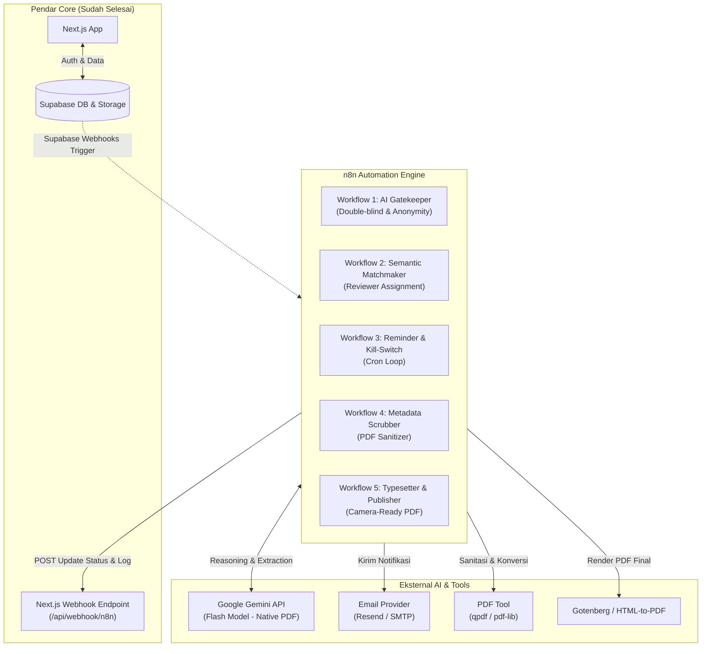
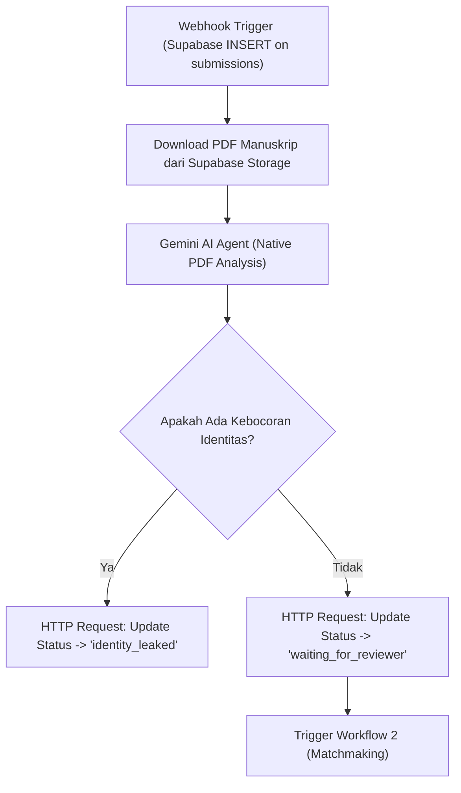
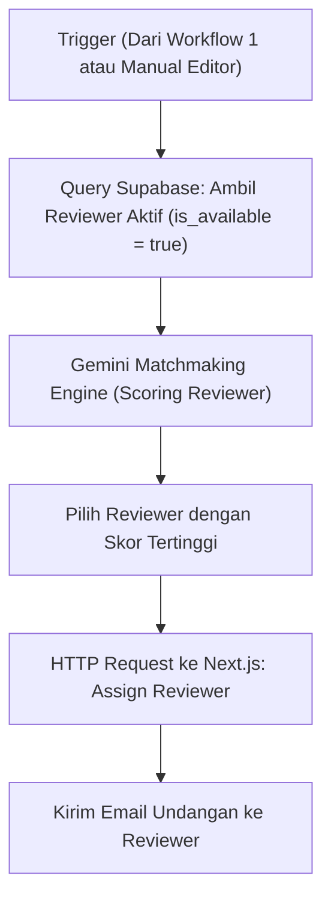
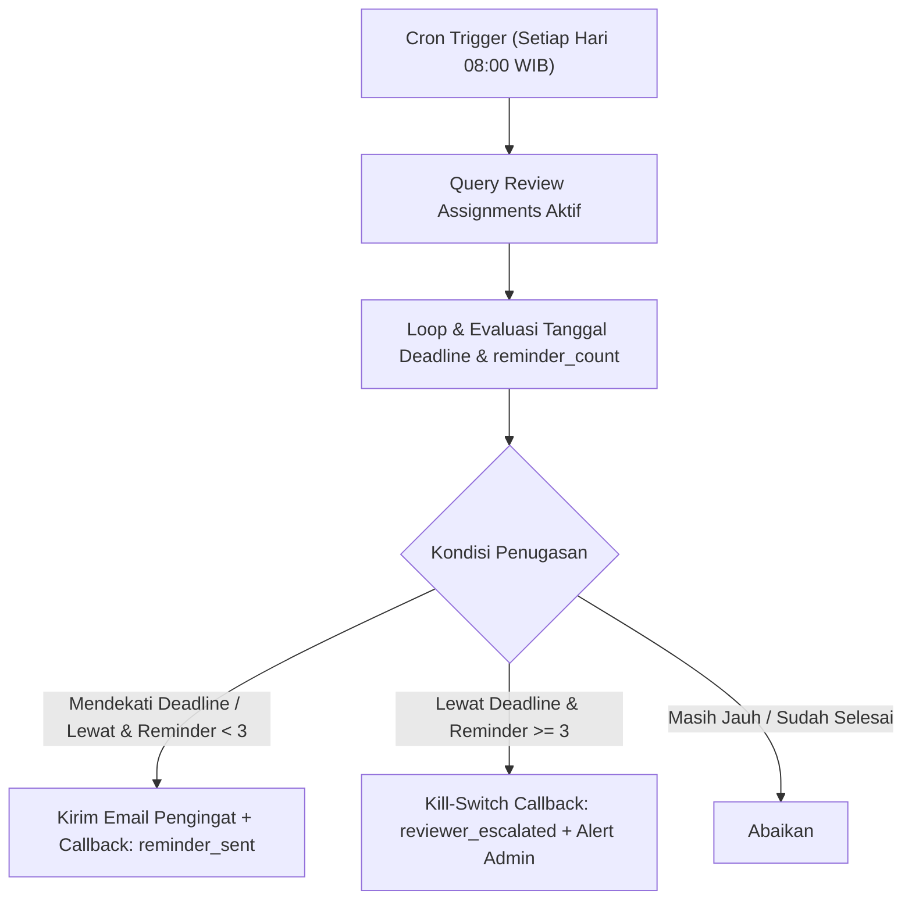
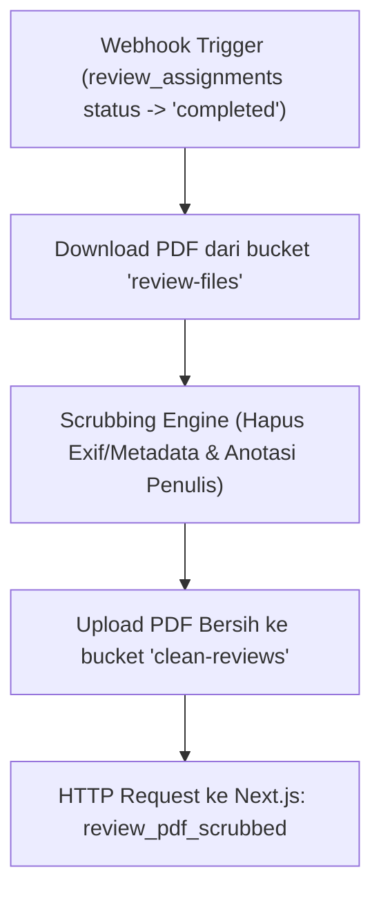
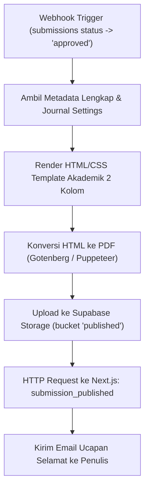

# 🤖 Pendar — Implementation Plan AI Agent Orchestration (v2.0)

> **Panduan Step-by-Step Orkestrasi AI & Workflow n8n untuk Journal Management System**  
> *Didesain khusus untuk pemula: lengkap dari setup environment nol, konfigurasi visual node, system prompts, API contracts, hingga pengujian.*

---

## 🧭 Ringkasan Arsitektur & Peran AI Agent

Di tahap sebelumnya (v1.0), antarmuka Next.js dan skema Supabase telah siap. Pada tahap v2.0 ini, kita membangun **otak otomatisasi** menggunakan **n8n** sebagai orkestrator yang menggerakkan model AI (LLM) untuk memproses naskah akademik secara otonom.



---

## 🛠️ Modul 0: Persiapan Environment & Kunci API (Zero-to-One)

Sebelum membuat workflow, Anda perlu menjalankan instance n8n dan menyiapkan kunci akses.

### 1. Menjalankan n8n di Komputer Lokal (Paling Mudah untuk Pemula)

Gunakan **Docker Desktop** (atau n8n Cloud jika ingin langsung online tanpa setup lokal):

1. **Install Docker Desktop** di Windows (jika belum ada).
2. Buka PowerShell dan jalankan perintah:
   ```powershell
   docker run -d --name pendar-n8n -p 5678:5678 -v n8n_data:/home/node/.n8n -e N8N_DIAGNOSTICS_ENABLED=false -e N8N_PERSONALIZATION_ENABLED=false n8nio/n8n
   ```
3. Buka browser ke: `http://localhost:5678`.
4. Buat akun admin pertama Anda (email & password lokal).

> [!TIP]
> **Menghubungkan Webhook Supabase ke n8n Lokal:**  
> Supabase Cloud memerlukan URL publik yang bisa diakses internet untuk mengirim webhook. Gunakan tunnel gratis seperti **ngrok**:
> ```powershell
> ngrok http 5678
> ```
> Salin URL `https://xxxx.ngrok-free.app` sebagai base URL n8n Anda.

---

### 2. Kredensial & Secrets yang Perlu Disiapkan

Di dashboard n8n (**Settings > Credentials**), buat akun koneksi berikut:

| Kredensial | Tipe di n8n | Cara Mendapatkan |
|---|---|---|
| **Google Gemini API** | Google Palm/Gemini API | Dapatkan API Key gratis di [Google AI Studio](https://aistudio.google.com/) |
| **Supabase Client** | Supabase API | Ambil `SUPABASE_URL` dan `SUPABASE_SERVICE_ROLE_KEY` dari project Supabase Anda |
| **Next.js Webhook Header** | Header Auth | Header Name: `Authorization`, Value: `Bearer <N8N_WEBHOOK_SECRET>` (sesuai `.env.local`) |
| **Resend / SMTP Email** | Resend API / SMTP | Dapatkan API key di [Resend.com](https://resend.com) untuk mengirim email |

---

## 🚀 Modul 1: Workflow 1 — AI Gatekeeper & Identity Leakage Verifier

### 🎯 Tujuan
Mencegah pelanggaran *double-blind review*. Ketika author mengirim naskah, AI memeriksa apakah naskah anonim (`anon_manuscript_url`) memuat identitas author, afiliasi, kontak, atau ucapan terima kasih yang membuka identitas.

### 📐 Desain Flowchart n8n


### 📋 Konfigurasi Node Step-by-Step

#### Step 1: Webhook Node (Trigger)
- **Path:** `/webhook/submission-created`
- **HTTP Method:** `POST`
- **Payload Data yang diterima dari Supabase:**
  ```json
  {
    "record": {
      "id": "e2b5e28a-...",
      "title": "Optimasi Algoritma...",
      "abstract": "Penelitian ini mengkaji...",
      "anon_manuscript_url": "manuscripts/author-id/manuscript.pdf",
      "status": "submitted"
    }
  }
  ```

#### Step 2: Supabase Storage Download Node (HTTP Request)
- **URL:** `{{ $env.SUPABASE_URL }}/storage/v1/object/manuscripts/{{ $json.record.anon_manuscript_url }}`
- **Method:** `GET`
- **Headers:** `apikey: {{ $env.SUPABASE_SERVICE_ROLE_KEY }}`
- **Response Format:** File / Binary

#### Step 3: AI Model Node (Google Gemini 1.5/2.0 Flash)
> [!NOTE]
> Gemini Flash mendukung input file PDF langsung tanpa perlu library ekstraksi teks OCR tambahan!

- **System Prompt:**
  ```text
  Anda adalah AI Gatekeeper untuk Journal Management System bereputasi tinggi dengan prinsip Double-Blind Peer Review yang ketat.
  
  Tugas Anda:
  1. Periksa seluruh halaman naskah manuskrip yang terlampir.
  2. Cari kebocoran identitas penulis, termasuk:
     - Nama penulis / peneliti
     - Afiliasi / institusi kampus / laboratorium
     - Alamat email, nomor kontak, atau akun media sosial
     - Bagian "Ucapan Terima Kasih" / "Acknowledgments" yang menyebut pembimbing atau penyandang dana beridentitas
     - Header/footer dokumen yang memuat nama atau instansi
  3. Ekstraksi 3-5 topik/kata kunci utama dari naskah tersebut.

  Wajib balas HANYA dengan format JSON valid berikut tanpa teks pengantar:
  {
    "is_identity_leaked": true/false,
    "leaked_details": "Jelaskan nama/afiliasi yang ditemukan dan di halaman mana, atau null jika bersih",
    "extracted_keywords": ["keyword1", "keyword2", "keyword3"]
  }
  ```

#### Step 4: Decision & HTTP Request Node ke Next.js
- Jika `is_identity_leaked === true`:
  - **URL:** `<NEXTJS_BASE_URL>/api/webhook/n8n`
  - **Method:** `POST`
  - **Headers:** `Authorization: Bearer <N8N_WEBHOOK_SECRET>`
  - **Body (JSON):**
    ```json
    {
      "type": "submission_status_update",
      "submission_id": "={{ $('Webhook').item.json.record.id }}",
      "status": "identity_leaked",
      "ai_result": "={{ $json.ai_output }}"
    }
    ```
- Jika `is_identity_leaked === false`:
  - **Body (JSON):**
    ```json
    {
      "type": "submission_status_update",
      "submission_id": "={{ $('Webhook').item.json.record.id }}",
      "status": "waiting_for_reviewer",
      "ai_result": "={{ $json.ai_output }}"
    }
    ```

---

## 🎯 Modul 2: Workflow 2 — Semantic Reviewer Matchmaker

### 🎯 Tujuan
Secara otomatis mencocokkan naskah baru dengan reviewer terbaik berdasarkan kesesuaian kata kunci keahlian (`expertise_keywords`) dan status ketersediaan reviewer (`is_available = true`).

### 📐 Desain Flowchart n8n


### 📋 Konfigurasi Node Step-by-Step

#### Step 1: Query Reviewer dari Supabase
- Gunakan Node **Supabase** atau **HTTP Request**:
  - `GET {{ $env.SUPABASE_URL }}/rest/v1/users_profile?role=eq.reviewer&is_available=eq.true&select=id,full_name,email,affiliation,expertise_keywords`
  - `apikey: {{ $env.SUPABASE_SERVICE_ROLE_KEY }}`

#### Step 2: AI Matchmaking Node (Gemini Flash)
- **Input Context:**
  - Judul naskah + Abstrak + Keywords hasil Workflow 1
  - Daftar kandidat reviewer (ID, Nama, Keahlian)
- **System Prompt:**
  ```text
  Anda adalah Editor-in-Chief AI yang bertugas memasangkan artikel ilmiah dengan reviewer paling kompeten.
  
  Data Naskah:
  - Judul: {{ $json.submission.title }}
  - Abstrak: {{ $json.submission.abstract }}
  - Topik: {{ $json.submission.keywords }}

  Daftar Kandidat Reviewer:
  {{ $json.available_reviewers }}

  Tugas:
  1. Analisis kecocokan domain keahlian setiap reviewer terhadap topik naskah.
  2. Berikan skor kecocokan 0-100 untuk setiap kandidat.
  3. Pilih 1 kandidat terbaik (skor tertinggi).

  Wajib output JSON:
  {
    "selected_reviewer_id": "UUID_REVIEWER_TERPILIH",
    "selected_reviewer_name": "NAMA_REVIEWER",
    "match_score": 95,
    "rationale": "Alasan singkat kecocokan keahlian..."
  }
  ```

#### Step 3: Callback ke Next.js Webhook
- **URL:** `<NEXTJS_BASE_URL>/api/webhook/n8n`
- **Method:** `POST`
- **Body (JSON):**
  ```json
  {
    "type": "reviewer_assigned",
    "submission_id": "={{ $json.submission.id }}",
    "reviewer_id": "={{ $json.selected_reviewer_id }}",
    "due_date": "={{ $now.plus({ days: 14 }).toISO() }}"
  }
  ```

#### Step 4: Kirim Email Notifikasi (Resend Node)
- **To:** `{{ $json.selected_reviewer_email }}`
- **Subject:** `[Pendar] Undangan Meninjau Naskah: {{ $json.submission.title }}`
- **HTML Body:**
  ```html
  <p>Yth. Bapak/Ibu <strong>{{ $json.selected_reviewer_name }}</strong>,</p>
  <p>Anda diundang untuk meninjau naskah ilmiah baru berjudul <em>"{{ $json.submission.title }}"</em> karena keahlian Anda yang sangat relevan.</p>
  <p>Silakan masuk ke dasbor Pendar untuk menerima atau menolak undangan ini dalam 3 hari ke depan.</p>
  <a href="https://pendar.ac.id/peninjau">Buka Dasbor Peninjau</a>
  ```

---

## ⏰ Modul 3: Workflow 3 — Automated Reminder & Kill-Switch Loop

### 🎯 Tujuan
Memastikan siklus peer-review tidak macet. Berjalan otomatis setiap hari untuk memeriksa deadline tugas review, mengirim teguran bertingkat (maksimal 3x), dan melakukan eskalasi otomatis ke admin jika reviewer pasif.

### 📐 Desain Flowchart n8n


### 📋 Konfigurasi Node Step-by-Step

#### Step 1: Schedule Trigger (Cron)
- **Cron Expression:** `0 8 * * *` (Setiap hari pukul 08:00).

#### Step 2: Query Assignments Aktif dari Supabase
- Ambil semua penugasan dengan status `invited` atau `accepted`:
  - `GET /rest/v1/review_assignments?status=in.(invited,accepted)&select=id,submission_id,reviewer_id,status,due_date,reminder_count,submissions(title),users_profile(email,full_name)`

#### Step 3: Evaluasi Logika Pengingat (Code Node / JavaScript)
```javascript
const items = $input.all();
const today = new Date();
const results = [];

for (const item of items) {
  const row = item.json;
  const dueDate = new Date(row.due_date);
  const diffDays = Math.ceil((dueDate - today) / (1000 * 60 * 60 * 24));
  const count = row.reminder_count || 0;

  // Logika 1: Pengingat 3 hari sebelum deadline atau sudah lewat tapi reminder < 3
  if ((diffDays <= 3 || diffDays < 0) && count < 3) {
    results.push({
      action: 'send_reminder',
      assignment_id: row.id,
      new_count: count + 1,
      reviewer_email: row.users_profile.email,
      reviewer_name: row.users_profile.full_name,
      paper_title: row.submissions.title,
      days_left: diffDays
    });
  } 
  // Logika 2: Kill-Switch jika sudah 3x ditegur dan tetap belum selesai
  else if (diffDays < 0 && count >= 3) {
    results.push({
      action: 'escalate_unresponsive',
      assignment_id: row.id,
      paper_title: row.submissions.title,
      reviewer_name: row.users_profile.full_name
    });
  }
}

return results;
```

#### Step 4: Eksekusi Cabang Aksi
- **Jika `action === 'send_reminder'`:**
  1. Kirim Email Pengingat ke Reviewer.
  2. POST ke Next.js Webhook:
     ```json
     {
       "type": "reminder_sent",
       "assignment_id": "={{ $json.assignment_id }}",
       "reminder_count": "={{ $json.new_count }}"
     }
     ```
- **Jika `action === 'escalate_unresponsive'`:**
  1. POST ke Next.js Webhook:
     ```json
     {
       "type": "reviewer_escalated",
       "assignment_id": "={{ $json.assignment_id }}"
     }
     ```
  2. Kirim Email Alert ke Redaksi/Admin bahwa reviewer gagal merespons.

---

## 🧹 Modul 4: Workflow 4 — Digital Footprint Scrubber (Sanitasi Metadata PDF)

### 🎯 Tujuan
Ketika reviewer mengunggah berkas PDF catatan revisi (`raw_review_pdf_url`), seringkali aplikasi (MS Word, Adobe Acrobat, macOS Preview) menyisipkan metadata nama reviewer di dalam properti PDF atau anotasi komentar. Workflow ini menghapus jejak metadata tersebut sehingga aman diunduh oleh author.

### 📐 Desain Flowchart n8n


### 📋 Implementasi Praktis untuk Pemula

Ada dua cara mudah menjalankan scrubbing PDF di n8n:
1. **Opsi JavaScript (Built-in n8n Code Node / pdf-lib):**
   Membaca berkas PDF dan mereset nilai Title, Author, Creator, Producer menjadi `Anonymous`.
2. **Opsi Shell / Docker Utility (qpdf / ExifTool):**
   ```bash
   exiftool -all= -overwrite_original catatan_reviewer.pdf
   ```

#### Callback ke Next.js Webhook
Setelah file bersih di-upload ke bucket `clean-reviews`:
- **URL:** `<NEXTJS_BASE_URL>/api/webhook/n8n`
- **Method:** `POST`
- **Body (JSON):**
  ```json
  {
    "type": "review_pdf_scrubbed",
    "assignment_id": "={{ $json.assignment_id }}",
    "clean_pdf_url": "clean-reviews/cleaned_{{ $json.assignment_id }}.pdf"
  }
  ```

---

## 🖨️ Modul 5: Workflow 5 — Typesetting & Auto-Publishing Agent

### 🎯 Tujuan
Ketika naskah disetujui oleh Editor (`status = 'approved'`), AI secara otomatis menyusun layout artikel akademik berstandar publikasi (layout 2 kolom, header jurnal, metadata sitasi, DOI/ISSN) dan menghasilkan PDF final siap unduh.

### 📐 Desain Flowchart n8n


### 📋 Konfigurasi Node Step-by-Step

#### Step 1: Render HTML Template
n8n menyiapkan HTML string dengan style tipografi jurnal akademik:
```html
<!DOCTYPE html>
<html>
<head>
  <style>
    @page { size: A4; margin: 20mm; }
    body { font-family: 'Times New Roman', serif; font-size: 10pt; line-height: 1.5; }
    .header { border-bottom: 2px solid #0f172a; padding-bottom: 5px; font-size: 8pt; }
    .title { font-size: 18pt; font-weight: bold; text-align: center; margin: 20px 0; }
    .authors { text-align: center; font-size: 10pt; margin-bottom: 20px; }
    .abstract-box { font-size: 9pt; background: #f8fafc; padding: 15px; margin-bottom: 20px; }
    .content-columns { column-count: 2; column-gap: 20px; text-align: justify; }
  </style>
</head>
<body>
  <div class="header">{{ journal_name }} | Volume {{ volume }}, Nomor {{ issue }} ({{ year }})</div>
  <div class="title">{{ title }}</div>
  <div class="authors">{{ authors }}</div>
  <div class="abstract-box"><strong>Abstrak:</strong> {{ abstract }}</div>
  <div class="content-columns">{{ body_content }}</div>
</body>
</html>
```

#### Step 2: Konversi ke PDF
Menggunakan instance Gotenberg (atau layanan HTML-to-PDF seperti DocRaptor / Browserless / Puppeteer Node).

#### Step 3: Callback ke Next.js Webhook
- **URL:** `<NEXTJS_BASE_URL>/api/webhook/n8n`
- **Method:** `POST`
- **Body (JSON):**
  ```json
  {
    "type": "submission_published",
    "submission_id": "={{ $json.submission_id }}",
    "final_pdf_url": "published/paper_{{ $json.submission_id }}.pdf",
    "volume": 1,
    "issue": 1
  }
  ```

---

## ⚙️ Modul 6: Setup Webhook Trigger di Supabase Dashboard

Agar Supabase dapat memanggil n8n secara real-time saat ada aksi di web, lakukan konfigurasi berikut:

1. Buka [Supabase Dashboard](https://supabase.com/dashboard) > Pilih Proyek Anda.
2. Masuk ke menu **Database** > **Webhooks**.
3. Klik **Create a new webhook**:
   - **Name:** `on_submission_created`
   - **Table:** `submissions`
   - **Events:** Centang `INSERT`
   - **Webhook URL:** `https://<URL_N8N_ANDA>/webhook/submission-created`
   - **HTTP Method:** `POST`
4. Buat webhook kedua untuk event selesai review:
   - **Name:** `on_review_completed`
   - **Table:** `review_assignments`
   - **Events:** Centang `UPDATE`
   - **Webhook URL:** `https://<URL_N8N_ANDA>/webhook/review-completed`
5. Buat webhook ketiga untuk approval terbit:
   - **Name:** `on_submission_approved`
   - **Table:** `submissions`
   - **Events:** Centang `UPDATE`
   - **Webhook URL:** `https://<URL_N8N_ANDA>/webhook/submission-approved`

---

## 🧪 Modul 7: Panduan Pengujian & Troubleshooting Pemula

### 1. Cara Menguji Setiap Node Tanpa Menunggu User Asli
1. Di n8n, klik tombol **Test step** pada setiap node.
2. n8n memiliki fitur **Pin Data**: Anda dapat menempelkan contoh JSON data submission dan menjalankannya berulang kali tanpa harus submit berkali-kali dari web.

### 2. Checklist Verifikasi End-to-End
| # | Pengujian | Hasil yang Diharapkan |
|---|---|---|
| 1 | Upload PDF beridentitas (ada nama penulis) | Status di web otomatis berubah menjadi `identity_leaked` dan muncul penjelasan AI |
| 2 | Upload PDF bersih anonim | Status otomatis berubah menjadi `waiting_for_reviewer` |
| 3 | AI Matchmaking | Assignment baru muncul di dasbor reviewer terpilih + email undangan terkirim |
| 4 | Trigger manual Cron Reminder | `reminder_count` bertambah 1 di tabel dan tercatat di `activity_log` |
| 5 | Trigger manual Kill-Switch | Assignment berstatus `escalated_unresponsive` dengan notifikasi merah di dasbor admin |
| 6 | Reviewer submit PDF ber-metadata | File di `clean-reviews` bersih dari metadata properti |

### 3. Masalah Umum & Solusinya
- **Error 401 Unauthorized dari Next.js:** Periksa apakah header `Authorization` di node n8n memiliki spasi setelah `Bearer ` dan nilai secret-nya persis sama dengan `N8N_WEBHOOK_SECRET` di `.env.local`.
- **Webhook Supabase tidak sampai ke n8n:** Pastikan URL n8n Anda bersifat publik (menggunakan ngrok jika berjalan di localhost).
- **Gemini Quota Exceeded:** Gunakan model `gemini-1.5-flash` yang memiliki limit RPM/RPD sangat tinggi di tier gratis.

---

## 📦 Tahapan Pengerjaan Rekomendasi (Sprint Plan)

Untuk kenyamanan Anda sebagai pemula, kerjakan secara bertahap:
- **Minggu 1:** Setup n8n + Gemini API + Buat **Workflow 1 (AI Gatekeeper)** terlebih dahulu sampai berhasil mendeteksi identitas.
- **Minggu 2:** Buat **Workflow 2 (Matchmaking)** dan sambungkan pengiriman email dengan Resend.
- **Minggu 3:** Buat **Workflow 3 (Reminder & Kill-Switch Loop)** menggunakan Cron.
- **Minggu 4:** Finalisasi **Workflow 4 (Scrubber)** dan **Workflow 5 (Typesetter)**.
